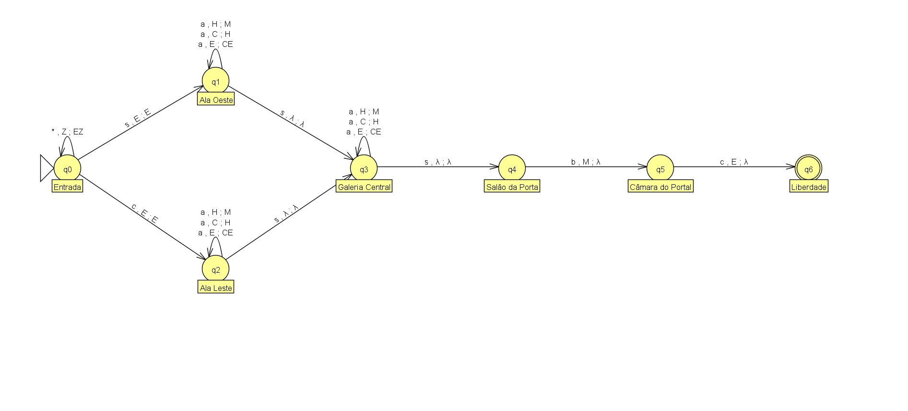

# A Masmorra da Chave Partida

Trabalho 2 de **Linguagens Formais e Autômatos** (IFC): um jogo web cuja lógica é um **autômato de pilha (PDA)**. O aventureiro percorre a masmorra coletando itens para desbloquear passagens até a saída, e cada interação é um símbolo processado pelo autômato em tempo real.

## Links e artefatos

| | |
|---|---|
| **Jogo (GitHub Pages)** | **[grogww.github.io/JogoComAutomatoDePilha](https://grogww.github.io/JogoComAutomatoDePilha/)** |
| Arquivo do JFLAP | [`jflap/masmorra-chave-partida.jff`](jflap/masmorra-chave-partida.jff) |
| Diagrama exportado do JFLAP | [`img/masmorra-chave-partida.jff.png`](img/masmorra-chave-partida.jff.png) |
| Motor do autômato | [`js/pda.js`](js/pda.js) (definição formal, transições e execução) |
| Testes automatizados | [`testes/`](testes/): 70 testes, incluindo a coerência com o `.jff` |

## Onde está cada requisito

| Requisito do enunciado | Onde ver |
|---|---|
| Enredo, personagem, itens que desbloqueiam passagens | Página, seção **O enredo**, e o mapa |
| Movimento por WASD criando o roteiro em tempo real | Modo **Explorar**: a fita abaixo do mapa mostra os símbolos gerados |
| Roteiro recebido por letras | Modo **Roteiro**: campo de texto, com execução passo a passo |
| Cada letra é uma ação do jogo | Tabela **Alfabeto de entrada Σ**, na página e abaixo |
| A pilha limita o jogo (empilhar e desempilhar) | A chave é montada **dentro da pilha** (C → H → M); sem M a porta não abre |
| ACEITA ou REJEITADA nos dois modos | Placa à direita e aviso sobre o mapa, sempre com o motivo |
| 4 exemplos na interface | Modo **Roteiro**, linha **Experimente** |
| Diagrama do JFLAP e regras de transição | Seções **Transições δ** e **Diagrama de estados** |
| De 5 a 10 estados | 7 estados (q0 a q6) |
| Estado atual, símbolo processado e pilha em tempo real | Placa fixa à direita, nos dois modos |

## Diagrama



## Como jogar

- **Explorar:** ande com `W` `A` `S` `D`. Andar **não** gera símbolo; o símbolo nasce quando o aventureiro encosta num objeto. Se não houver transição, a execução é rejeitada; ao entrar no portal final, é aceita.
- **Roteiro:** digite a sequência (ex.: `*saasasbc`) ou clique num exemplo, e acompanhe passo a passo.

A tecla `S` só move o personagem. O símbolo `s` é gerado ao atravessar uma passagem.

## Definição formal

M = (Q, Σ, Γ, δ, q0, Z, F)

- **Q** = {q0, q1, q2, q3, q4, q5, q6}: Entrada, Ala Oeste, Ala Leste, Galeria Central, Salão da Porta, Câmara do Portal, Liberdade
- **Σ** = {`*`, `a`, `s`, `b`, `c`}
- **Γ** = {Z, E, C, H, M}
- **q0** = estado inicial; **Z** = símbolo inicial da pilha; **F** = {q6}
- **Aceitação por estado final:** o roteiro é aceito se, ao consumir toda a entrada, o autômato estiver em q6.
- **Determinístico:** em cada estado, para cada par (símbolo, topo), existe no máximo uma transição.

| Σ | Ação no jogo | | Γ | Significado |
|---|---|---|---|---|
| `*` | Coletar a estrela-selo | | Z | Fundo da pilha (mochila vazia) |
| `a` | Coletar um pedaço da chave | | E | Estrela-selo |
| `s` | Atravessar uma passagem | | C | Chave com 1 pedaço (cabo) |
| `b` | Usar a chave mestra na porta | | H | Chave com 2 pedaços (cabo + haste) |
| `c` | Entrar num portal | | M | Chave mestra completa (3 pedaços) |

## Transições δ

Notação do JFLAP: `entrada, desempilha ; empilha` (λ = vazio).

| Nº | De | Para | Transição | Significado |
|---|---|---|---|---|
| 1 | q0 | q0 | `*, Z ; EZ` | Pega a estrela-selo |
| 2 | q0 | q1 | `s, E ; E` | O corredor para a Ala Oeste só abre com o selo |
| 3 | q0 | q2 | `c, E ; E` | O portal azul para a Ala Leste só ativa com o selo |
| 4 | q1 | q1 | `a, E ; CE` | 1º pedaço: cabo |
| 5 | q1 | q1 | `a, C ; H` | 2º pedaço: haste encaixa no cabo |
| 6 | q1 | q1 | `a, H ; M` | 3º pedaço: chave mestra completa |
| 7 | q1 | q3 | `s, λ ; λ` | Grade da Ala Oeste para a Galeria Central |
| 8 | q2 | q2 | `a, E ; CE` | 1º pedaço: cabo |
| 9 | q2 | q2 | `a, C ; H` | 2º pedaço: haste encaixa no cabo |
| 10 | q2 | q2 | `a, H ; M` | 3º pedaço: chave mestra completa |
| 11 | q2 | q3 | `s, λ ; λ` | Grade da Ala Leste para a Galeria Central |
| 12 | q3 | q3 | `a, E ; CE` | 1º pedaço: cabo |
| 13 | q3 | q3 | `a, C ; H` | 2º pedaço: haste encaixa no cabo |
| 14 | q3 | q3 | `a, H ; M` | 3º pedaço: chave mestra completa |
| 15 | q3 | q4 | `s, λ ; λ` | Grade para o Salão da Porta |
| 16 | q4 | q5 | `b, M ; λ` | A porta só abre com a chave mestra |
| 17 | q5 | q6 | `c, E ; λ` | O selo libera o portal final |

## Exemplos

| Roteiro | Resultado | Motivo |
|---|---|---|
| `*saasasbc` | ACEITA | 2 pedaços na Ala Oeste e 1 na Galeria |
| `*casaasbc` | ACEITA | 1 pedaço na Ala Leste e 2 na Galeria |
| `*sasasbc` | REJEITADA | Chegou à porta com a chave incompleta: δ(q4, b, H) não existe |
| `*caasaasbc` | REJEITADA | Tentou encaixar um 4º pedaço: δ(q3, a, M) não existe |

**No JFLAP:** abra o `.jff`, use **Input → Multiple Run**, escolha **Final State** e cole os roteiros acima. Os resultados são os mesmos do jogo.

## Decisões de modelagem

- **A pilha monta a chave.** Os estados não sabem quantos pedaços o jogador tem; só o topo da pilha (C, H, M) sabe. É a pilha, e não os estados, que controla a regra principal.
- **A estrela fica no fundo (LIFO).** E só volta ao topo depois que a chave mestra é usada na porta, e é ela que libera o portal final.
- **Ramificação com símbolos diferentes.** As duas saídas da Entrada usam `s` (corredor) e `c` (portal azul). Com o mesmo símbolo, o autômato seria não determinístico.
- **Estado = sala.** Andar dentro da sala não muda o autômato; só as interações geram símbolos. As grades se fecham atrás do jogador, então o mapa e o autômato andam juntos.
- **3 pedaços por sala de coleta.** Há 6 pedaços ao alcance em qualquer caminho, mas a chave só tem 3 encaixes. Assim, as 8 palavras aceitas pelo autômato (2 rotas × 4 divisões dos pedaços entre a ala e a Galeria) podem todas ser jogadas andando.
- **Sem transição = rejeição**, nos dois modos, sempre com o motivo em linguagem do jogo e em notação formal.

## Estrutura e testes

```
index.html          página do jogo
css/estilo.css      visual
js/pda.js           motor do autômato (usado pelos dois modos)
js/mapa.js          mapa, movimento WASD e iluminação
js/painel.js        placa do autômato, tabelas, diagrama e rastreio
js/main.js          liga motor, mapa e painel
jflap/              arquivo .jff
img/                diagrama exportado do JFLAP
testes/             testes do motor e de coerência com o .jff
```

HTML, CSS e JavaScript puros, sem bibliotecas. O `index.html` também abre localmente com dois cliques.

Os testes conferem que o motor é idêntico ao arquivo do JFLAP (mesmos estados e mesmas 17 transições) e que os dois dão o mesmo resultado em todas as palavras de até 14 símbolos. Para rodar, com Node 18 ou superior:

```
node --test
```
